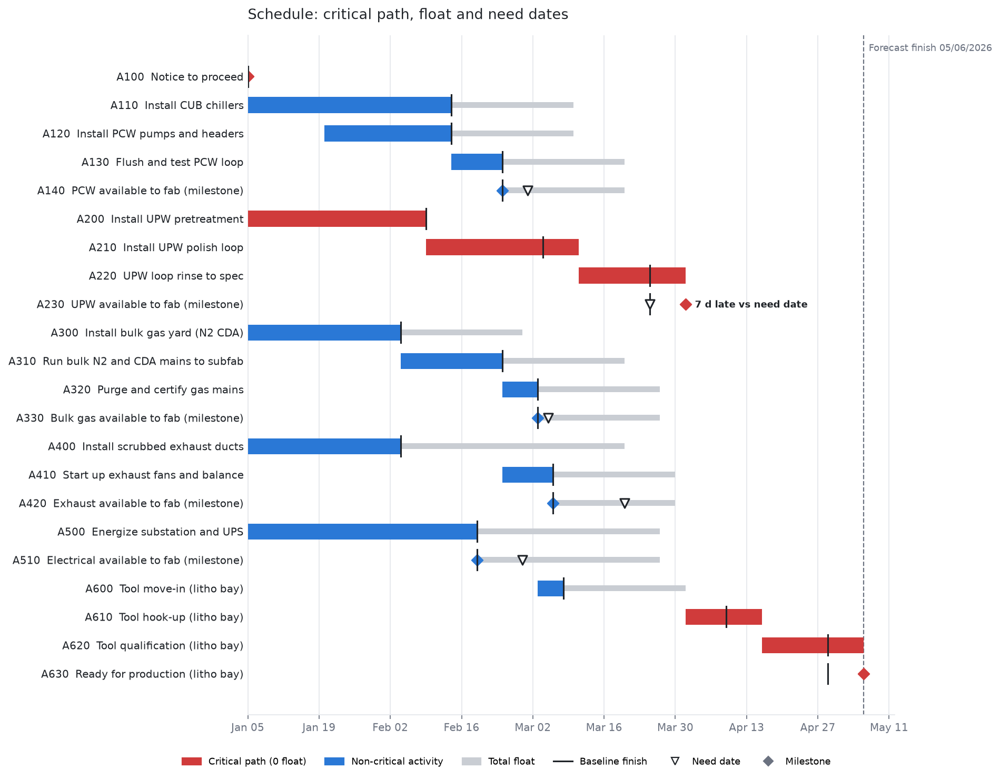
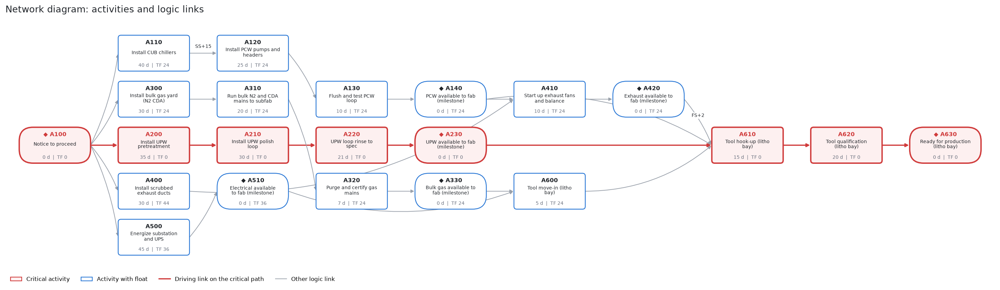
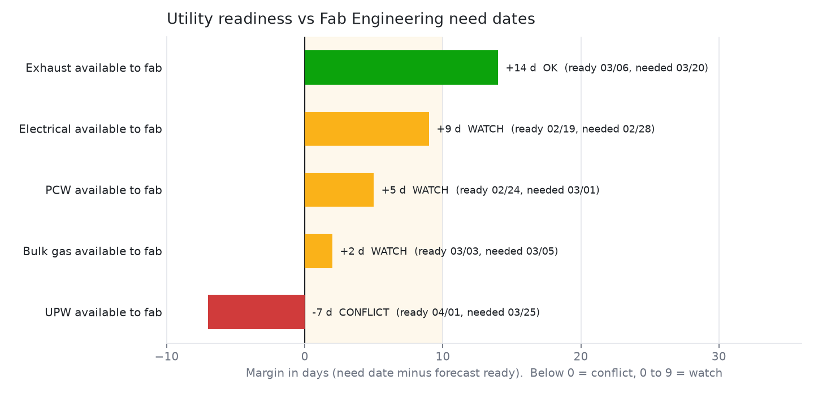

# schedule-health

**Try it in your browser: https://schedule-health-demo.streamlit.app** (no install needed)

A Python tool that turns any project schedule into an early-warning report. It works for
construction, infrastructure, engineering, IT or any other project that has activities,
durations and logic links.

It runs the Critical Path Method, checks whether key milestones will be ready by the date
the next team needs them, measures slip against the baseline and runs DCMA-style quality
checks. Use it as a web app, from the command line, or as a daily pipeline that feeds a
Power BI or Tableau dashboard.

## What it does

1. **Critical Path Method**: forward pass, backward pass, total float, free float and the
   critical path. Supports finish-to-start, start-to-start, finish-to-finish and
   start-to-finish links with lags or leads.
2. **Need-date alignment** (optional): compares each key milestone with the date another team
   needs it and labels the margin `CONFLICT` (late), `WATCH` (under 10 days, adjustable) or `OK`.
3. **Baseline slip**: forecast finish vs. baseline finish for every activity.
4. **Schedule quality checks**: a simplified subset of the DCMA 14-point assessment
   (missing logic, leads, lags, relationship types, high float, high duration, negative float).
5. **Charts**: Gantt chart, network (precedence) diagram with the critical path along the
   center row and right-angle links that never pass behind a box, need-date readiness and
   baseline slip.

## Run it

```
pip install -r requirements.txt
python schedule_health.py sample_infra_schedule.csv need_dates.csv 2026-01-05
python visualize.py
```

## Use it with your own project

1. Download a template from [`templates/`](templates) or from the app's sidebar:
   - `schedule_template.xlsx`: one Excel workbook with `instructions`, `schedule` and
     `need_dates` sheets (easiest)
   - `schedule_template.csv` and `need_dates_template.csv`: the same as two CSV files
2. Replace the example rows with your activities. Keep the column headers.
3. Upload the file at https://schedule-health-demo.streamlit.app and set the project name and
   start date. Files you upload are used only in your session and are not stored.

From Primavera P6 or MS Project, export activity ID, name, original duration, predecessors
(with relationship type and lag) and baseline finish to Excel, then rename the columns to
match the template.

## Interactive web app (Streamlit)

Live at https://schedule-health-demo.streamlit.app, or run it locally:

```
streamlit run streamlit_app.py
```

Opens in the browser at http://localhost:8501. Load a sample or upload your own Excel or
CSV files, then edit any duration or link in the table to test a what-if: the forecast
finish, need-date margins, critical path, charts and quality checks recalculate at once and
show the change against the schedule as loaded. The report and every table can be
downloaded. The app, the command line tool and the Power BI pipeline all use the same engine
(`schedule_health.analyze`).

## Automated reporting pipeline into Power BI

`pipeline.py` turns the tool into a daily, unattended feed for a Power BI report:

```
python pipeline.py --data-date 2026-02-02 --charts
```

Each run:

1. runs the CPM and checks on the latest schedule export;
2. passes a **quality gate** (unique IDs, calculated dates present, a critical path exists,
   every need-date milestone found). If anything fails, nothing is published and the
   report keeps the last good data, so leadership never sees wrong numbers;
3. publishes stable tables to `powerbi/current/` (activities, need dates, quality checks,
   KPIs), written atomically so Power BI never reads a half-written file;
4. adds a dated snapshot to `powerbi/history/` (a rerun on the same data date replaces it),
   so the report can trend forecast finish, float erosion and need-date margins;
5. logs the run (time, status, finish, worst margin, error message) to `powerbi/refresh_log.csv`.

Connect Power BI with the queries in `powerbi/queries.pq` (Power Query M, typed columns,
plus suggested DAX measures). Schedule the run daily with Windows Task Scheduler.
`run_pipeline.bat` uses a virtual environment in the project folder if you made one
(`python -m venv .venv` then `.venv\Scripts\pip install -r requirements.txt`), otherwise the
`python` on your PATH:

```
schtasks /Create /TN "Schedule health pipeline" /TR "C:\path\to\schedule-health\run_pipeline.bat" /SC DAILY /ST 06:00
```

In the Power BI service, keep the `powerbi` folder in OneDrive or SharePoint (or use an
on-premises data gateway) and set the dataset's scheduled refresh to run after the pipeline.

## Inputs

| File or sheet | Required columns | Optional columns |
|---|---|---|
| schedule | `id`, `duration` (calendar days, 0 = milestone) | `name`, `area`, `predecessors`, `baseline_finish` |
| need_dates (optional) | `milestone`, `need_date` | `needed_by` |

Files can be `.csv` or `.xlsx`. Headers are not case sensitive, and the older column name
`utility_milestone` is still accepted. Command line: `python schedule_health.py my_schedule.xlsx
my_schedule.xlsx 2026-03-02` reads both sheets from one workbook; use `-` in place of the need
dates file if the project has none.

Link syntax in `predecessors` (separated by `;` or `,`): `A130` (finish-to-start), `A110SS+15`
(start-to-start, 15-day lag), `A420FS+2`, `A500FF-3` (3-day lead). Spaces and lower case are
fine, and ids may contain `-` or `.` (such as `CON-1010` or `1.2.3`): the longest id in the
schedule that starts a link wins. Durations can be plain numbers or text such as `10 days`;
part days round up to the next whole day. CSV files can be UTF-8 or the Windows encoding Excel
uses for plain CSV.

## Outputs

| File | Content |
|---|---|
| `out_activities.csv` | early and late dates, total and free float, critical flag, slip vs. baseline |
| `out_need_date_alignment.csv` | forecast ready date vs. need date, margin, status |
| `out_quality_checks.csv` | quality checks with targets |
| `out_links.csv` | every logic link: predecessor, successor, type, lag, driving, on the critical path |
| `out_health_report.txt` | short text report |
| `chart_gantt.png` | Gantt chart: critical path in red, total float, baseline finish, need dates |
| `chart_utility_readiness.png` | margin of each need-date milestone against its need date (red, amber, green) |
| `chart_baseline_slip.png` | forecast finish minus baseline finish per activity |
| `chart_network.png` | network diagram: activity boxes (duration, total float) and logic links, critical path in red |

`visualize.py` only reads the CSV outputs, so the same files can feed Power BI and the charts.

## Sample result

The sample is an invented industrial-facility utility schedule (cooling water, ultrapure
water, bulk gas, exhaust, electrical) feeding one equipment hook-up.

```
Critical path: A100 > A200 > A210 > A220 > A230 > A610 > A620 > A630

Milestone readiness vs need dates (worst first):
  [CONFLICT] A230 UPW available to fab (milestone): ready 2026-04-01, needed 2026-03-25, margin -7 d
  [WATCH   ] A330 Bulk gas available to fab (milestone): ready 2026-03-03, needed 2026-03-05, margin +2 d
  [WATCH   ] A140 PCW available to fab (milestone): ready 2026-02-24, needed 2026-03-01, margin +5 d
  [WATCH   ] A510 Electrical available to fab (milestone): ready 2026-02-19, needed 2026-02-28, margin +9 d
  [OK      ] A420 Exhaust available to fab (milestone): ready 2026-03-06, needed 2026-03-20, margin +14 d
```







## Limits

- Durations are calendar days. Primavera P6 and MS Project use work calendars, which change
  the date math but not the logic.
- No resources or date constraints yet.
- Sample data is invented for illustration.

Planned next steps: read Primavera P6 XER exports directly and add work calendars.

## License

MIT
